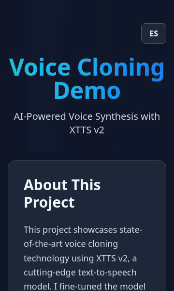

# Voice Clone Portfolio Project

  

AI-powered **Argentinean Spanish voice cloning** using **XTTS v2**, fine-tuned to replicate a specific voice profile with high naturalness and clarity. This project provides both a **web interface** and **API access** for easy experimentation and integration.

---

## New !!! Android app

The New Android app is published on this [repo](https://github.com/jonorl/voice-clone-mobile)

## Key Features

* **High‑quality Spanish synthesis** using a fine‑tuned XTTS v2 model
* **Near real-time generation** for short and medium-length texts
* **Advanced controls** (temperature, top_p, top_k) to shape voice output
* **Reproducible results** via deterministic seeding
* **User-friendly web UI** built with Gradio
* **API access** for programmatic usage

---

## Live Demo / Space

Use the web interface to generate speech directly from your browser:

1. Enter Spanish text
2. (Optional) Adjust synthesis parameters
3. Click **Generate Speech**
4. Play or download the generated audio

---

## How It Works

This project is built on **Coqui XTTS v2**, a multilingual text-to-speech model capable of voice cloning. The model has been **fine-tuned on Spanish voice samples** to reproduce a specific speaker’s vocal characteristics, including:

* Intonation
* Rhythm
* Accent
* Voice timbre

---

## Synthesis Parameters

| Parameter       | Range       | Description                                                                                              |
| --------------- | ----------- | -------------------------------------------------------------------------------------------------------- |
| **Temperature** | 0.1 – 1.0   | Controls randomness in speech prosody. Lower values sound more stable; higher values add expressiveness. |
| **Top P**       | 0.1 – 1.0   | Nucleus sampling threshold. Lower values reduce diversity.                                               |
| **Top K**       | 1 – 100     | Limits candidate tokens during generation.                                                               |
| **Seed**        | Any integer | Ensures reproducible audio output when reused.                                                           |

---

## Tech Stack

* **Model**: Coqui XTTS v2
* **Interface**: Gradio
* **Language**: Python
* **Deployment**: Hugging Face Spaces

---

## Development

- `npm run dev` - Start the dev server
- `npm run build` - Build for production
- `npm run lint` - Run ESLint
- `npm run typecheck` - Type-check without building
- `npm test` - Run the Jest tests (`test:watch`, `test:coverage` also available)

The API's `/health` endpoint reports whether the model files are mounted and which commit is deployed; each deploy waits for it to report the new commit before passing.

---

## Ethical Use Notice

This project demonstrates voice cloning technology for **educational and experimental purposes only**. Ensure that you:

* Have **explicit permission** to clone any individual’s voice
* Do **not** use generated audio for impersonation, fraud, or deception
* Comply with all applicable laws and platform policies

---

## License

This Space uses **XTTS v2**, which is distributed under the **Coqui Public Model License**. Please review the license before commercial or large-scale usage.

---

## Acknowledgments

* [Coqui TTS](https://github.com/coqui-ai/TTS) for XTTS v2
* [Gradio](https://gradio.app/) for the web interface
* Hugging Face Spaces for hosting

---